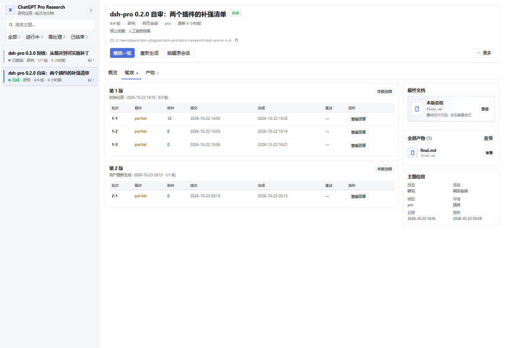

# ChatGPT Pro Research

在 DeepSeek Harness（DSH）里，用真实的 ChatGPT Pro 网页会话做无人值守的多轮调研：自动提问、按成功判据裁决并汇总成一份可复核的文档。

[](https://dsh.pub/zh/plugins/chatgpt-pro-research/)
[](https://www.npmjs.com/package/chatgpt-pro-research)
[](LICENSE)


> English: Unattended multi-round research through a real ChatGPT Pro web session, with local records and a DSH sidebar.

> **风险提示**：这是订阅网页自动化，不是官方 API。自动化网页可能违反服务条款、触发风控或导致账号受限；页面改版也会让它失效。请自行评估风险，不要把登录态、Cookie 或凭据写进仓库或日志。



*已完成主题的概览：运行汇总（自动生成）、轮次与产物；宿主交付稿 `report.md` 会优先显示。*

## 它解决什么问题

- 把一个研究问题拆成多轮：提问 → 追问 → 按 `criteria` 裁决 → 汇总，不需要你盯着每一轮。
- 每一轮的问题、答复、裁决、运行汇总和宿主交付稿都落盘，可以中断、恢复、取消或人工核对。
- 侧边栏「Pro Research」列出主题、轮次、状态与记录路径；卡住时能直接处理。
- 适合文献/竞品/方案/技术选型调研；不适合需要官方 API 合规保证、需要多账号并行、或必须逐字引用的场景。


## 0.3.5：安全边界与恢复一致性

- 材料检查真实路径和敏感原目标，固定已验证来源；暂存附件缺失或越界时明确停止，不偷偷省略。
- 预览、下载、原生打开、逐轮 ZIP 和原始答复拒绝真实路径越界；文本预览 2,000,000 字节、单产物/逐轮 ZIP 100 MiB，在完整读取前执行限制。
- 两轮之间中断后正确恢复授权下轮；重试不扩张轮次预算；取消自动裁决后不会被后到结果改回完成。
- 当前运行汇总带版本/轮次归属，接受新一代结果不会套用旧摘要。完整审查与边界见 [0.3.5 记录](https://github.com/Octo-o-o-o/dsh-pro/blob/main/docs/validation/release-0.3.5-2026-10-29.md)。
- 本次发布 Git 0.3.5；npm 仍为 0.3.4，社区市场版本独立，不应据市场安装命令推定装到了最新版。

## 0.3.4：可靠裁决与 local 交付（已保留）

- 裁决为推理与 JSON 预留共同的输出预算；只有正常完成且判据满足才接受。
- `read_round` 读取真实答复/裁决；`read_report` 返回旧稿及 revision；`write_report` 写入已授权主题的固定交付文件。
- 支持 `project` / `local`，不要求放宽宿主文件权限；写稿经过 DSH 工具权限检查，带版本与轮次覆盖校验及并发覆盖保护。
- 原答复、运行汇总与宿主整理的交付稿分别保留。设计图片与 HTML 必须另做视觉、交互验收。

## 前置条件

- DSH `>= 0.2.1-rc.3 < 0.3.0`（本版本实测 `0.2.1-rc.3`）。
- Node.js 22+（DSH 自带 runtime 也可以）。
- 本机安装 Google Chrome；插件使用一个独立的 Chrome profile，不碰你日常浏览器。
- 一个可登录 ChatGPT 网页的账号；首次登录必须有人工操作（验证码/Cloudflare）。
- 网页通道固定单账号、单会话；不做多账号并行、扇出或答复合并。

## 安装

### 从 Git commit（当前推荐）

```bash
dsh plugin --profile <profile> add github:Octo-o-o-o/chatgpt-pro-research#<40-char-commit>
```

`<40-char-commit>` 用 `v0.3.5` tag 对应完整 SHA；`<profile>` 换成你的 profile（例如 `desktop`、`web`）。当前源码/Git 版本为 `0.3.5`；请核对 Release 已发布再安装，历史真实服务证据和本轮替身验证分开记录。

共享传输层收紧网页完成判定：只接受当前回答的完成控件，文本停顿、代码复制按钮不算结束；上一轮未结束时不发送追问。发送前失败保留浏览器现场，可恢复重试当前轮；点击发送后结果未知仍须核对。模型选择必须核验，实际标签写入回执；研究卡可显式传 `store="local"`，以工具返回的 `store` / `path` 为准。

### 从 dsh.pub（收录后推荐）

```bash
npx dshpub add Octo-o-o-o/chatgpt-pro-research
```

dsh.pub 会把仓库固定到一个公开 commit 再安装。市场收录与 Git/npm 发版独立，安装前请核对市场显示的版本与 commit。

### 从 npm

```bash
dsh plugin --profile <profile> add chatgpt-pro-research
```

安装时建议指定版本 `@0.3.4`，便于复现；`desktop` 与 `web` profile 均受支持。

### 启用

安装后重启 DSH，打开 **设置 → 插件**，确认 **ChatGPT Pro Research** 已启用；也可以在 profile 的 `dsh.profile.bundles` 里确认包名。插件加载后，工具列表会出现 `pro_research`，侧边栏会出现 **Pro Research** 面板。

## 首次登录

```text
pro_research(action="login")
```

插件会打开一个独立的 Chrome 窗口。登录 ChatGPT 后关闭窗口即可；登录态保存在 `~/.dsh/pro-research/browser`，与研究插件、设计插件共用，只需登录一次。

## 快速开始

第一次先跑一个**不需要准备材料**的单轮主题，确认链路通：

```text
pro_research(
  action="start",
  confirmed=true,
  title="第一次试跑",
  question="给两个可行的周末阅读计划，比较取舍",
  brief="面向通勤族，各给一个方案，输出一张取舍表、一个推荐理由和一个未决问题",
  criteria=["有取舍表", "有明确推荐", "有一个未决问题"],
  rounds=1
)
```

跑完后在侧边栏「Pro Research」里看：运行汇总、轮次、回答和裁决。

需要带材料时再加：

```text
pro_research(
  action="start",
  confirmed=true,
  title="DSH 插件市场对比",
  question="比较 dsh.pub 与 dsh.so 的收录规则和安装方式",
  brief="面向插件作者，输出一张对比表 + 一份提交检查清单",
  criteria=["覆盖两个市场的提交门槛", "给出可执行的提交流程", "标注不确定项"],
  materials=["docs/market-notes.md"],
  rounds=3
)
```

其余动作：`status`、`list`、`resume`、`cancel`、`delete`、`human_check`、`accept`、`review`、`review_cancel`、`wake`、`regenerate`、`probe`、`login`。

- `start` 需要 `confirmed=true`，表示你已经确认问题、判据和轮次。
- `human_check` **只用于核对“消息/附件是否真的提交”**（`submitted` / `not_submitted` / `reopen`），不是内容质量验收；内容是否采纳用 `accept` / `regenerate` / `continue`。
- `resume` 恢复中断的主题；`cancel` 取消；`delete` 删除终态主题；`review` / `review_cancel` 处理 capped 后的交接；`regenerate` 可附 `materials` 补新材料。

## 设置

在 **设置 → 插件 → ChatGPT Pro Research** 里配置：

| 设置 | 默认 | 说明 |
|---|---|---|
| `rounds` | `3` | 每个主题默认轮次上限（1–10）。 |
| `model` | `pro` | ChatGPT 页面上的模型：`pro` 或 `thinking`。 |
| `store` | `project` | 记录位置：`project`（仓库 `docs/research`）或 `local`（DSH 本机）。 |
| `autoStart` | `false` | 研究卡是否跳过点击直接开跑。 |
| `autoReview` | `true` | capped 后唤醒原会话检查产物，决定接受或继续。 |
| `notify` | `stall-only` | 通知策略：`stall-only` 只在卡住时提醒，`all` 完成也提醒。 |
| `stallMinutes` | `45` | 无进展判定分钟数；生成中不计时。 |
| `maxRoundMinutes` | `90` | 单轮墙钟上限（分钟）。 |
| `maxFiles` | `12` | 单轮附件数量上限。 |
| `maxTotalMB` | `24` | 单轮附件总大小（MB）。 |
| `rawAnswers` | `local` | 原始答复保存位置：`local` 或 `repo`；公开仓库请用 `local`。 |
| `rawAnswersDir` | 空 | `local` 模式的原文目录；留空用 `~/.dsh/chatgpt-pro-research/raw`（设计插件为 `~/.dsh/gpt-image-design/raw`）。 |
| `headless` | `false` | 无头模式仅建议用于自检；首次登录必须有头。 |
| `judgeProvider` | 空 | 自动裁决的 LLM provider；留空用 DSH 默认模型，填 `off` 关闭。 |
| `judgeModel` | 空 | 自动裁决的 model；与 provider 同时填写可覆盖。 |

## 产物与记录

```text
<project>/docs/research/<slug>/     # store=project
├── topic.json                       # 问题、判据、轮次、状态
├── rounds/                          # 00-question、NN-question、NN-answer（repo 时）、NN-verdict
├── materials/                       # manifest.json 与 material 快照
├── artifacts/round-NN/              # 图片、HTML/代码、ZIP（按轮）
├── receipts/                        # NN.json 与 history.ndjson
├── events.ndjson                    # 追加式状态/答复事件
├── final.md                         # 运行汇总（自动生成），不是交付物
└── report.md                        # 宿主交付稿（宿主按判据整理后写入）
```

- `final.md` 是机械汇总；面板会把它标成「运行汇总（自动生成）」。
- `report.md` 由宿主整理并通过插件的 `write_report` 写入：结论与适用条件、判据逐条（met/partial/unmet/unknown + 轮次证据）、未决问题、产物入口。面板优先展示 `report.md`。
- 没有 `report.md` 时，面板明确显示“宿主尚未整理交付稿”，不会把 `final.md` 当成交付稿。

- `store=local`：`~/.dsh/chatgpt-pro-research/projects/<project>-<hash>/<slug>/`。
- 原始答复默认只在 `~/.dsh/chatgpt-pro-research/raw/<topic-id>/`；只有 `rawAnswers=repo` 时才复制进项目。
- 登录态：`~/.dsh/pro-research/browser`（敏感，不要提交）。
- 主题列表、轮次和状态也会显示在侧边栏面板里。

## 验证清单

装好后按这个顺序确认：

1. 工具列表出现 `pro_research`，侧边栏出现 **Pro Research** 面板。
2. `pro_research(action="probe")` 返回浏览器/登录态状态。
3. `action="login"` 能打开 Chrome，并能登录 ChatGPT。
4. 跑一个 1 轮的小主题，确认 `docs/research/<slug>/` 下出现 `topic.json`、轮次目录和 `final.md`。
5. 刷新侧边栏，确认主题、状态、轮次和记录路径都在。
6. 用 `read_round` / `read_report` / `write_report` 整理 `report.md`，刷新后确认面板显示「宿主交付稿」和覆盖范围。
7. 故意把 `judgeProvider` 指向不可用模型跑一轮，确认主题停在「待判断」（`review_from=answered`），答复仍在；修好后 `resume` 能完成。

## 安全与隐私

- **会出网**：问题、brief、判据、材料和你选择的附件会发送到 `chatgpt.com`；自动裁决使用你配置的 DSH LLM provider。
- **本地保存**：Cookie/登录态在 `~/.dsh/pro-research/browser`（两个插件共用）；记录在项目 `docs/research` 或 `~/.dsh/chatgpt-pro-research`；原始答复在 `~/.dsh/chatgpt-pro-research/raw`。
- **权限边界**：插件以 DSH 进程权限运行，可以读写上述目录、启动本机 Chrome、通过 DSH 的工具/模型服务工作；它不读取与调研无关的浏览器 profile。
- **文件管理器**：插件先把路径限制在 topic 目录内，再把路径作为参数数组交给 `explorer.exe` / `open` / `xdg-open`；不经过 shell，也不把路径拼进命令行。
- **不会**把登录态、Cookie、完整原始答复写进仓库；`rawAnswers` 默认 `local`。
- **清理**：面板「更多 → 删除主题」或 `action=delete`（终态主题、需 `confirmed=true`）会删除主题目录、原始答复与面板记录；卸载时见下文。不要把 `~/.dsh/pro-research` 或 `~/.dsh/chatgpt-pro-research` 提交到任何仓库。

## 已知限制

- 网页改版、Cloudflare 挑战、账号风控或额度限制都可能让某一轮失败；插件会保留已完成的轮次，不会假装成功。
- 只支持单账号、单会话；没有多账号并行。
- 页面上的模型/功能以 ChatGPT 网页实际提供为准，`model=pro` 不保证每个账号都有。
- 自动裁决看的是文本答复，不等同于人工评审；重要结论请用 `accept` / `regenerate` / `continue` 明确裁决。
- `human_check` 只用于确认消息/附件是否真的提交，不评价内容质量。
- 自动裁决失败（例如模型没有返回 JSON）时，答复会保留，主题停在「待判断」：可以接受、继续、重新生成，或修好 `judgeProvider` / `judgeModel` 后 `resume` 重试。
- 附件受 `maxFiles` / `maxTotalMB` 限制；单轮超时受 `maxRoundMinutes` 限制。
- 没有官方 API 通道；需要 API 合规保证的场景请另找方案。

## 故障排查

| 现象 | 先检查 |
|---|---|
| 登录窗口没出现 | 是否有残留的插件 Chrome 窗口占用 profile；关掉后重试 `login`。 |
| 登录后仍显示未登录 | `probe` 看状态；确认 `~/.dsh/pro-research/browser` 可写；必要时重新 `login`。 |
| 卡在 Cloudflare/验证码 | 在弹出的窗口里手动完成，再关闭窗口；不要用无头模式做首次登录。 |
| 某一轮一直不结束 | `status` 看轮次；到 `maxRoundMinutes` 会标记；用 `cancel` 停止轮询。 |
| 提交状态不明（`unknown_submission`） | 去页面核对消息/附件，再 `human_check` 填写依据；不要重发。 |
| 主题卡在 capped/reviewing | `review` 让原会话检查产物，或核对后 `accept` / `continue` / `regenerate`；`human_check` 只用于核对是否真的提交。 |
| 自动裁决失败 | 答复已保留，主题在「待判断」；修好 `judgeProvider` / `judgeModel` 后 `resume` 重试，或直接 `accept` / `continue` / `regenerate`。 |
| 附件没带上 | 检查 `maxFiles`、`maxTotalMB` 和文件路径；材料里的图片/文件要实际存在。 |
| 重启 DSH 后轮次丢失 | 已发送但未回执的轮次会停在待人工核对；用 `status` / `resume` 处理，不要自动重发。 |

## 本地验证记录

2026-10-23，DSH `0.2.1-rc.2`，空 `web` profile，从公开 commit `9e3853f` 安装：

- `--dump-config` 显示 `# == chatgpt-pro-research` 组合包层；
- `GET /chatgpt-pro-research/topics` 返回 `200 {"topics":[]}`；
- 侧边栏 **Pro Research** 入口和空面板正常加载。

> 这是安装/加载验证，不等于真实 ChatGPT 登录和完整多轮调研的验收；后者需要你自己的账号。

## 0.3.4 验证边界

本版将裁决输出预算提高到 8,192 token，避免推理耗尽预算后截断 JSON；异常仍保留原答复与结束原因，不会误判成功。新增固定主题范围的交付工具，支持宿主在“工作区内修改”模式下整理 local 交付稿。首次人工登录、付费生图 API、macOS/Linux 真实端到端仍需各环境独立验收。

2026-10-29 在 Windows、DSH `0.2.1-rc.3`、真实 ChatGPT Pro 与 DeepSeek-V4-Pro 裁决模型上完成单轮研究：发送前超时后恢复原主题，收到真实答复，自动裁决 `accepted`，再通过插件 `write_report` 写入并回读 local `report.md`。未手动 accept，也未放宽宿主权限。详情见 [0.3.4 验证记录](https://github.com/Octo-o-o-o/dsh-pro/blob/main/docs/validation/release-0.3.4-2026-10-29.md)。

## 兼容性

| 项 | 值 |
|---|---|
| DSH | `0.2.1-rc.3` 实测；`engines.dsh` 为 `>=0.2.1-rc.3 <0.3.0` |
| Node.js | 22+ |
| 浏览器 | 本机 Google Chrome（稳定版） |
| 平台 | Windows 已验证；macOS/Linux 使用对应的 Chrome 启动路径，未在仓库内声明实测 |
| 插件版本 | Git `0.3.5`；npm `0.3.4` |

## 禁用与卸载

**临时禁用**：**设置 → 插件** 关闭 **ChatGPT Pro Research**；或从 profile 的 `dsh.profile.bundles` 移除 `chatgpt-pro-research`，重启 DSH。

**卸载**：

```bash
dsh plugin --profile <profile> remove chatgpt-pro-research
```

然后按需删除：

- `~/.dsh/pro-research/`（Chrome 登录态与 profile 锁；**两个插件都不再使用时才删除**）
- `~/.dsh/chatgpt-pro-research/`（原始答复、registry、sessions 与 `store=local` 的记录）
- 项目里的 `docs/research/`（只删你确认不要的主题）

## 开发

源码和开发说明在 monorepo：[Octo-o-o-o/dsh-pro](https://github.com/Octo-o-o-o/dsh-pro/tree/main/packages/research)。

```bash
npm install
npm test
npm run typecheck
npm run build
node scripts/smoke-bundle.mjs
```

本仓库是发布仓库：`lib/` 是构建产物，请不要直接改 `lib/`；改源码请到 monorepo 的 `packages/research`。

## License

MIT。
